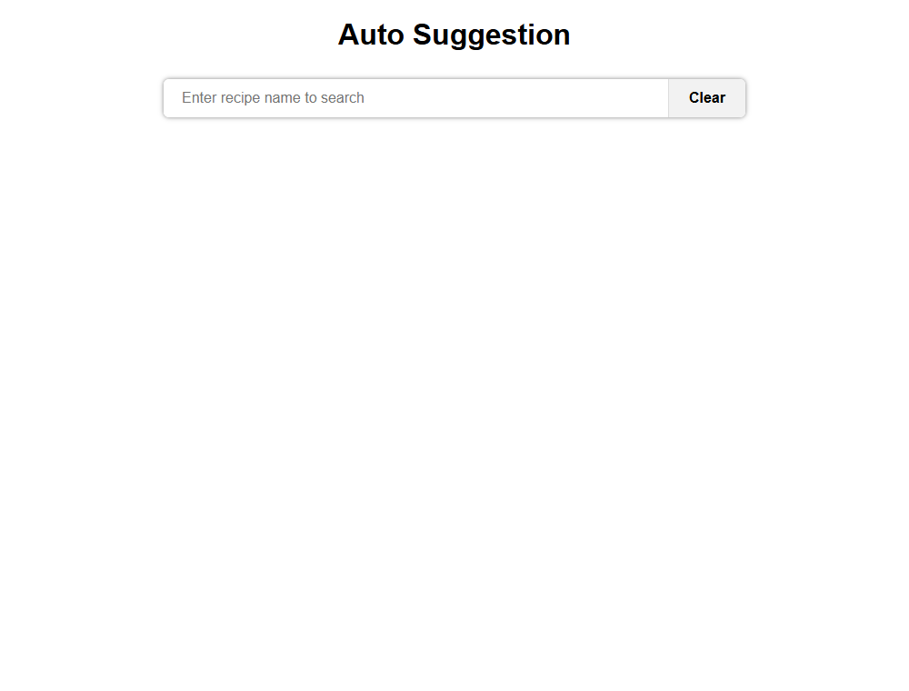
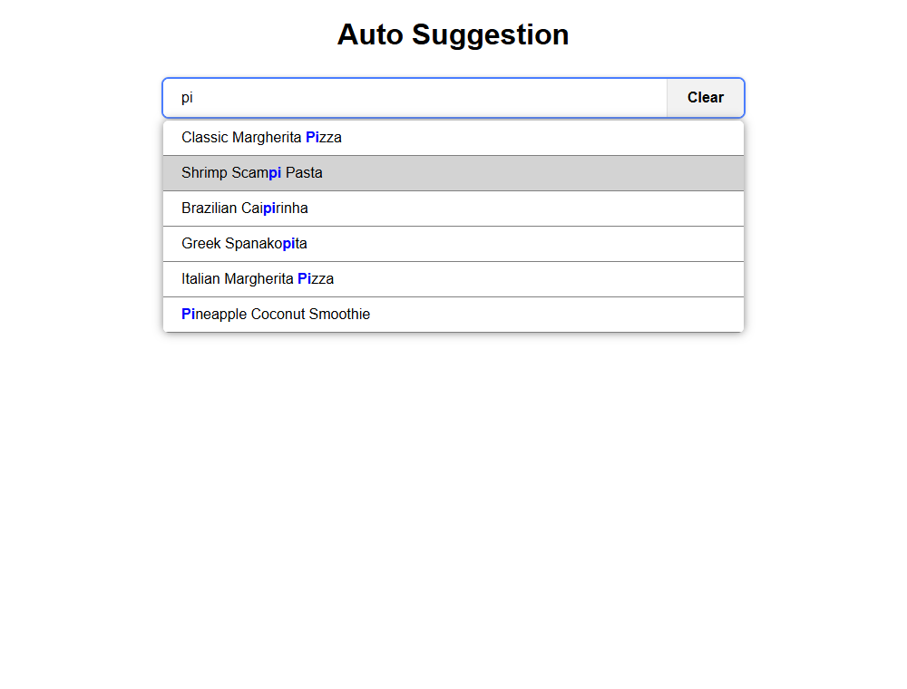
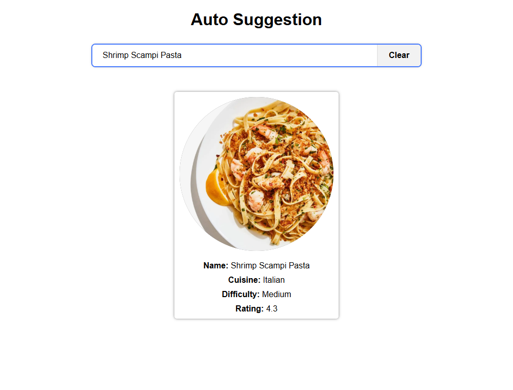

# Auto Suggestion on Search

A typeahead / auto-suggest search built with **React + Vite**. Type a recipe name and get live suggestions from the [DummyJSON recipes API](https://dummyjson.com/docs/recipes).

Live demo: https://noob-auto-suggestion.netlify.app/

## Features
- Suggestions appear as you type, with the matched text highlighted
- **Debounced** input (300ms) so the API isn't hit on every keystroke
- In-flight requests are **aborted** when the query changes, so stale responses never overwrite newer ones
- Results are **cached** per query
- Keyboard support: `ArrowUp` / `ArrowDown` to navigate, `Enter` to select, `Escape` to close
- Mouse support: click a suggestion to select it, click outside to close
- Loading, empty ("No results found") and error states
- `Clear` button resets the input, suggestions and selected recipe
- Accessible: ARIA combobox / listbox pattern with `aria-activedescendant`

## Screenshots

### Initial screen


### Suggestions while typing


### Selected recipe (via click or Enter)


## Run locally
```bash
npm install
npm run dev      # start dev server
npm test         # run the Vitest suite
npm run build    # production build into dist/
```

## Project structure
```
src/
  components/
    AutoSuggestion.jsx   state, keyboard handling, ARIA
    SuggestionsList.jsx  list rendering, highlight, scroll into view
    DisplayMenu.jsx      selected recipe card
  hooks/
    useDebounce.js       generic debounce hook
    useSuggestions.js    fetch + AbortController + cache
  services/recipes.js    API call
  utils/highlight.js     regex-free match highlighting
  __tests__/             unit and component tests
```
